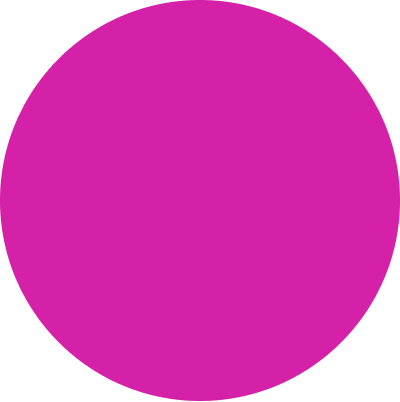
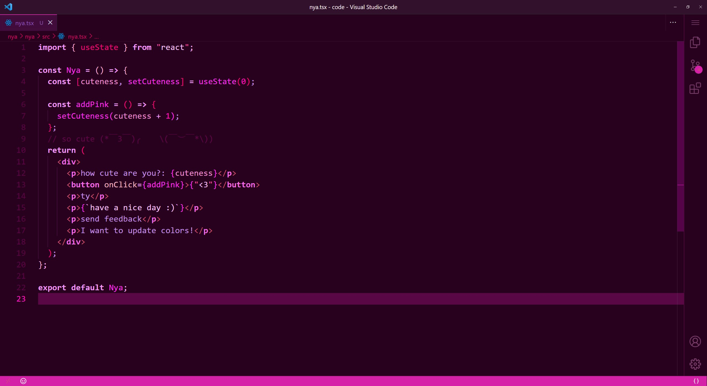
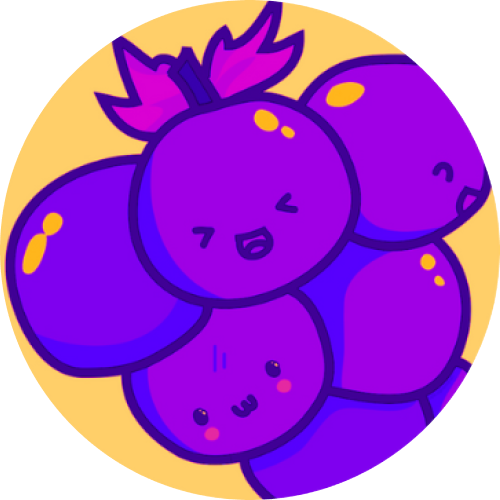
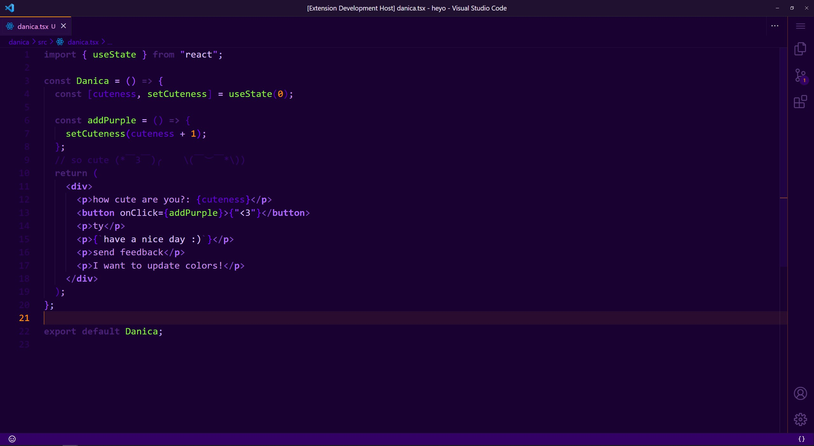
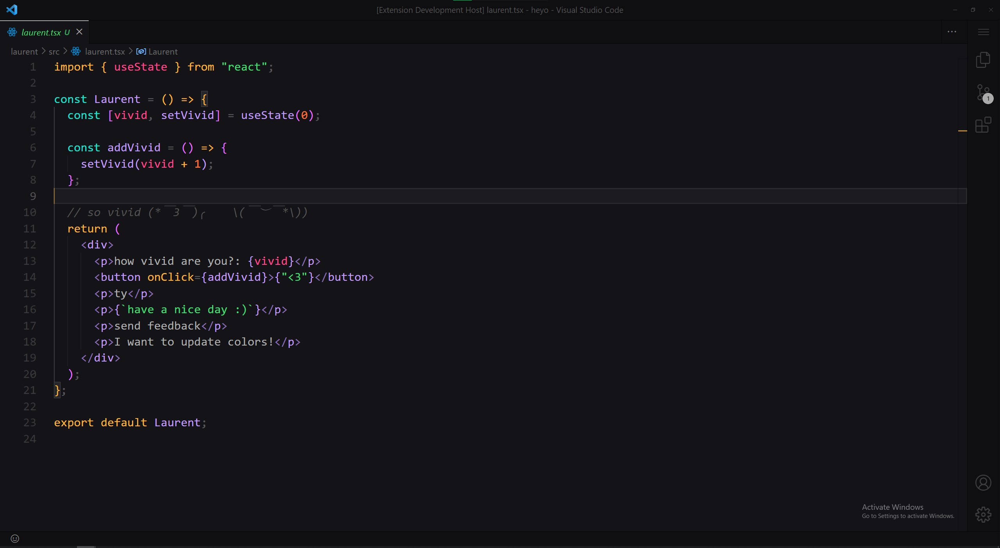
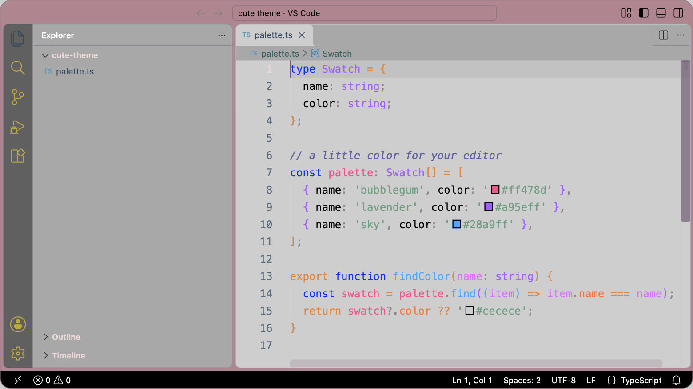

# vscode-themes

little outfits i made for my editor, some with a little help from friends ✨

## nya

a pink theme.

[install nya](https://marketplace.visualstudio.com/items?itemName=dani.nya)

## danica

a purple theme co-designed with danica.

[install danica](https://marketplace.visualstudio.com/items?itemName=dani.danica)

## laurent

a vivid black theme minus blue.

[install laurent](https://marketplace.visualstudio.com/items?itemName=dani.laurent)

## cute theme

my first theme, with bright colors on a soft gray editor.

[install cute theme](https://marketplace.visualstudio.com/items?itemName=dani.cute-theme-hi)

